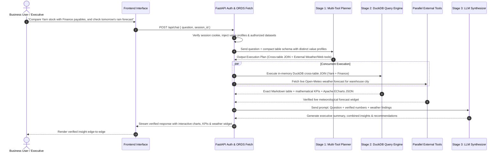

# Enterprise AI Hub — System Architecture & Agent Technical Documentation
**Version:** 2.5.0-ENTERPRISE  
**Author:** Enterprise AI Engineering Team  
**Platform:** Oracle Cloud Infrastructure Autonomous Database (ORDS) + In-Memory DuckDB Engine + FastAPI + Modern Web Client  

---

## 1. Overview & Core Mission
**Enterprise AI Hub** is an enterprise-grade Autonomous Data Intelligence Agent. It enables authorized executives, analysts, and business users to interact with live corporate databases through natural language, voice queries, verified aggregations, interactive charts, and multi-format document generation.

Unlike conventional chatbots that hallucinate numbers or execute dangerous arbitrary SQL queries directly against production databases, Enterprise AI Hub uses an **isolated dual-model planner/synthesizer architecture** paired with an **in-memory deterministic query sandbox (DuckDB vectorization + Python sandbox)**.

---

## 2. High-Level System Architecture

```mermaid
graph TD
    Client[Web & Mobile Client / Browser]
    
    subgraph FastAPI Application Server
        Auth[RBAC & Session Guard<br/>HMAC-SHA256 Cookie]
        FastPath[Fast-Path Export Router]
        LLM_Planner[Stage 1: Multi-Tool Planner<br/>Groq / Llama 3.3 70B]
        QueryEngine[Stage 2: In-Memory Engine<br/>DuckDB Vectorized Sandbox]
        ExtTools[Parallel Tool Router<br/>Weather, Firecrawl, Forex, PSX]
        LLM_Synthesizer[Stage 3: LLM Synthesizer<br/>Executive Takeaways & Insights]
        ExportEngine[Multi-Format Export Engine<br/>PDF, Excel, Word, PPT]
    end
    
    subgraph Oracle Cloud Infrastructure
        ORDS[Oracle REST Data Services / ORDS]
        AutonomousDB[(Oracle Autonomous Database<br/>HR, Products, Yarn, Tax, Finance)]
        OAuth[OAuth 2.0 Security Layer]
        StorageConfig[AI_STORAGE_CONFIG<br/>Zero Secret Files on Disk]
    end

    Client <-->|HTTPS / TLS 1.3| Auth
    Auth --> FastPath
    Auth --> LLM_Planner
    LLM_Planner --> QueryEngine
    LLM_Planner --> ExtTools
    QueryEngine --> LLM_Synthesizer
    ExtTools --> LLM_Synthesizer
    LLM_Synthesizer --> Client
    FastPath --> ExportEngine
    ExportEngine --> Client
    
    FastAPI Application Server <-->|Encrypted REST| ORDS
    ORDS <--> AutonomousDB
    ORDS <--> OAuth
    ORDS <--> StorageConfig
```

---

## 3. The AI Agent Pipeline (Planner → In-Memory Engine & Tools → Synthesizer)

The core agent intelligence operates in three decoupled stages:



### Stage 1: The Multi-Tool Planner (Semantic Translation & Tool Routing)
- **Role:** Understands intent, translates business language into structured execution plans, and routes parallel external tools.
- **Input:** User prompt + available table names + column schemas enriched with **categorical value profiles** (e.g. `STATUS: ['IN_STOCK', 'RESERVED']`).
- **Output:** Validated JSON plan containing:
  ```json
  {
    "mode": "join",
    "left_table": "Yarn Inventory",
    "right_table": "Suppliers Ledger",
    "join_on": "supplier_id",
    "filters": [["status", "==", "in stock"]],
    "group_by": ["supplier_name"],
    "aggs": [
      {"op": "sum", "col": "stock_kg", "as": "Total Stock KG"},
      {"op": "avg", "col": "payables_pkr", "as": "Pending Payables PKR"}
    ],
    "external_tools": [
      {"tool": "weather", "city": "Faisalabad"},
      {"tool": "web_search", "query": "live Pakistan cotton yarn rates"}
    ],
    "chart": {
      "type": "bar",
      "title": "Yarn Stock vs Payables by Supplier",
      "cat_col": "supplier_name",
      "val_cols": ["Total Stock KG", "Pending Payables PKR"]
    }
  }
  ```

### Stage 2: The In-Memory Analytical Engine (DuckDB Vectorization + Self-Healing)
- **Location:** `server/agent/query_engine.py`
- **Zero Disk Storage:** Operates 100% in `:memory:` with zero temporary disk files.
- **Performance Benchmark:** Processes **50,000+ rows in ~150 ms** (135x faster than standard Python loops).
- **Cross-Table JOIN Support:** Executes in-memory `INNER`, `LEFT`, `RIGHT`, and `FULL` hash joins across multiple datasets.
- **Self-Healing Fuzzy Matching:**
  - Delimiter normalization (`IN_STOCK` == `in stock` == `in-stock`).
  - Case-insensitive comparisons and punctuation stripping.
  - Substring & typo tolerance via sequence matching (`difflib` similarity > 0.84) preventing 0-row query failures.

### Stage 3: The Synthesizer (Executive Presentation)
- **Role:** Delivers concise, high-value executive summaries, verified numbers, and visual charts.
- **Rules:**
  1. **Executive Takeaway:** Starts immediately with a 1–2 sentence direct answer.
  2. **Mathematical Truth:** Strict adherence to Stage 2 verified numbers. Zero hallucinations.
  3. **Visual Charts:** Formats Apache ECharts JSON configs for rich visual rendering.
  4. **Multi-Source Fusion:** Combines verified database tables, weather widgets, and live web intelligence into a single coherent answer.

---

## 4. Multi-Tenant Role-Based Access Control (RBAC)

The system enforces strict multi-tenant boundaries between **Administrators** (`Nexus`, `Admin`) and **Regular Users**:

| Capability | Administrator (`Nexus` / `Admin`) | Regular Business User |
| :--- | :---: | :---: |
| **Chat & Conversational Analysis** | ✅ Full Access | ✅ Full Access (Authorized Tables Only) |
| **Interactive ECharts & Visuals** | ✅ Full Access | ✅ Full Access |
| **PDF, Excel, Word & PPT Exports** | ✅ Full Access | ✅ Full Access |
| **Cross-Table Joins & DuckDB** | ✅ Full Access | ✅ Authorized Datasets Only |
| **Uploaded Document Ingestion** | ✅ Full Access | ✅ Session In-Memory Scope |
| **Live Database Grid Inspection** | ✅ Live Studio & Record Browser | ⛔ Restricted (403 Forbidden) |
| **Raw Column & Schema Inspector** | ✅ Column Data Types & Samples | ⛔ Restricted (Hidden) |
| **Cloud Storage Configuration** | ✅ Admin REST Management | ⛔ Read-Only / Server Internal |

---

## 5. Document Ingestion & Uploaded Table Intelligence

When users upload spreadsheets or documents in chat:
1. **Spreadsheets (`.xlsx`, `.xls`, `.csv`):** Extracted into structured in-memory datasets (`[UPLOAD] filename.xlsx`).
2. **Session Integration:** Uploaded tables are automatically exposed to the Stage 1 Planner.
3. **Cross-Table Analysis:** Users can compare and join uploaded vendor invoices or budget files with live Oracle ERP database tables in real time.

---

## 6. Zero Local Storage & Cloud ORDS Configuration

1. **Zero Disk Storage:** No SQLite databases, local JSON credential files, or user session logs are written to the web server filesystem.
2. **Dynamic Cloud ORDS Storage Config:**
   - Google Drive credentials and folder IDs are stored securely in `AI_STORAGE_CONFIG` inside Oracle DB.
   - The FastAPI backend loads credentials dynamically via `GET /engine/storage/config`.
   - Eliminates all sensitive JSON secret files from the Git repository for clean GitHub push protection.

---

## 7. Document Generation & File Export Engine

The agent generates fully formatted enterprise documents entirely in memory:
- **PDF Engine (ReportLab):** Branded headers, dynamic column layouts, Unicode typography (`Amiri-Regular.ttf`).
- **Excel Engine (OpenPyXL):** Formatted worksheets, bold headers, numeric formatting, alternating row colors.
- **Word Engine (python-docx):** Structured reports with heading hierarchies and styled tables.
- **PowerPoint Engine (python-pptx):** Executive slide decks with title cards, KPI highlights, and data tables.

---

*Enterprise AI Hub Architecture Document — Version 2.5.0-ENTERPRISE — Confidential & Proprietary*
